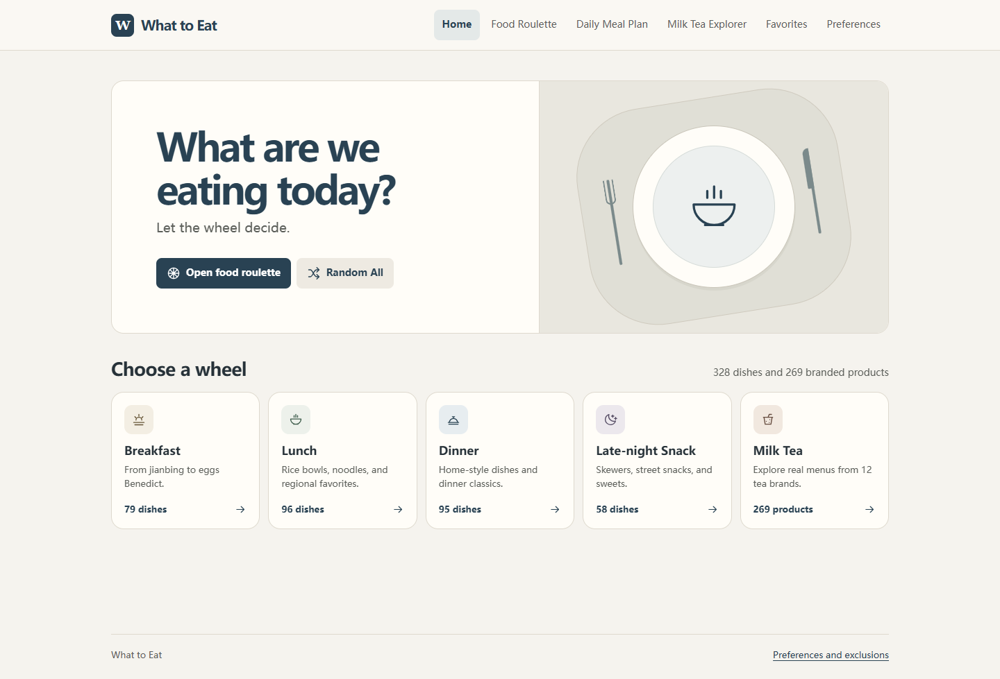
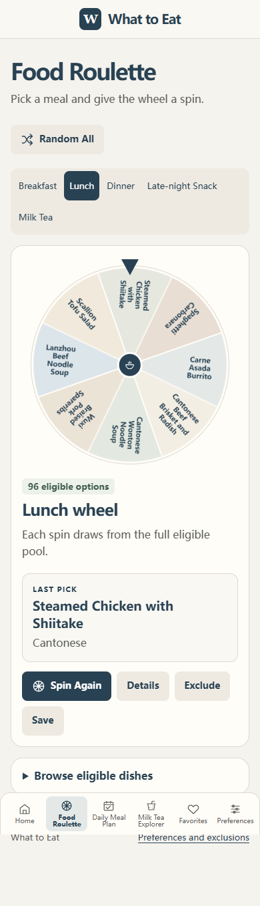

# What to Eat

What to Eat is a responsive, English-language food picker inspired by GPAway. Spin independent wheels for breakfast, lunch, dinner, a late-night snack, or a branded tea-shop product. Build a daily plan, search Chinese tea menus, save favorites, and exclude individual items. Preferences and past picks stay in browser storage.




## Catalog

| Wheel | Records |
| --- | ---: |
| Breakfast | 79 |
| Lunch | 96 |
| Dinner | 95 |
| Late-night Snack | 58 |
| Milk Tea Explorer | 269 |
| **Total** | **597** |

The tea catalog covers 12 brands and includes 59 records classified as milk tea or fresh milk tea. The Milk Tea wheel includes the brands' other named menu products, such as fruit tea, brewed tea, coffee, soft serve, and desserts. The [catalog guide](docs/catalog.md) lists each brand's count and menu sources.

Each spin draws a uniformly shuffled sample of up to eight eligible records from the category's full pool. The winner is chosen uniformly from those segments and the wheel stops with the pointer inside the winning segment. The previous result is skipped when a second eligible option exists. Meal plans use the same eligibility logic.

## Run locally

Use Node.js 22.12 or later and npm.

```sh
npm ci
npm run dev
```

Open the printed local URL. The frontend uses JavaScript ES modules and CSS with Vite. There is no runtime API, account requirement, or backend.

```sh
npm test
npm run build
npm run preview
```

## Deploy to GitHub Pages

Push the project files to a public repository on the `main` branch. In **Settings → Pages → Build and deployment**, set **Source** to **GitHub Actions**. Run **Deploy to GitHub Pages** from the Actions tab if the first push occurred before Pages was enabled. The workflow runs catalog and roulette tests, builds `dist/`, then uploads and deploys it. The deployment job publishes the URL.

Vite uses a relative base path. Hash navigation works under a repository subpath and supports direct links to pages and wheels.

## Contribute

Create a branch and run `npm ci`. Use the [catalog guide](docs/catalog.md) when adding dishes, correcting menu data, or updating availability. Keep existing IDs stable so saved favorites and exclusions continue to work. Run `npm test` and `npm run build` before opening a pull request. Include source links for menu changes and describe which flows you verified.

## License

Project code and original documentation are available under the [MIT License](LICENSE). Brand and product names identify the products documented in the menu sources.

